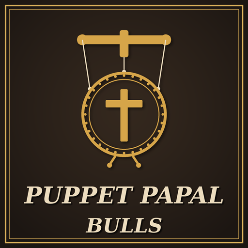

# Puppet Papal Bulls

A Crusader Kings III mod that lets you command a Pope who is your puppet to enact papal bulls. In the base game, a Pope you control as a puppet can excommunicate, grant claims or appoint cardinals on your command, but the bulls stay in his hands: only a player who is the Head of Faith can enact one. With this mod, the four bulls are puppet actions: you choose the bull and its target, and the Pope issues it in his own name.

- **Game version:** 1.20.x
- **Mod version:** 1.0.0
- **Author:** [Sourenics](https://github.com/Sourenics)
- **Steam Workshop:** [Puppet Papal Bulls](https://steamcommunity.com/sharedfiles/filedetails/?id=3831434191)

## Features

- **Four new puppet actions** for an external clerical puppet who heads a faith with a papacy, such as the Pope. They appear in your **Decisions** window, marked with the puppet icon, and are listed under your puppet's other actions in the intrigue window:

  | Puppet action | What the bull does |
  |---|---|
  | Enact a Bull: Call a Crusade | Calls a Great Holy War against the kingdom you choose |
  | Enact a Bull: Declare a Heresy | Declares a rite of the faith a heresy |
  | Enact a Bull: Permit a Tenet | Makes a tenet permitted for the whole faith |
  | Enact a Bull: Forbid a Tenet | Makes a tenet prohibited for the whole faith |

- **Only for players.** The actions are only available when the puppeteer is a player. AI rulers never use them.
- **The vanilla rules of the bull apply to the Pope.** He must be an adult available to act, his realm must have a Church Authority law, he pays the piety cost, and the five-year cooldown of each bull is the same one he uses for his own bulls. A Call a Crusade bull needs a faith that can wage Great Holy Wars, no Great Holy War already under way and a valid target; tenet bulls are not available during an Ecumenical Council; a rite can only be declared a heresy if it is not the mainline rite and diverges enough.
- **No extra cost or consequences** for you: the Pope pays the piety, as when he enacts a bull himself.
- **The bull is the vanilla one.** It uses the game's own bull events, so the faith's rulers get the usual letter, and the effects are the same as a bull the Pope enacts on his own.
- **All game languages.** Every text comes from the game's own localization of the bulls.

## Requirements

- **By God Alone** (the DLC that adds puppets and papal bulls).

## Installation

### Steam Workshop

Subscribe on the Steam Workshop page and enable the mod in the Paradox launcher.

### Manual

1. Download this repository (green **Code** button → **Download ZIP**).
2. Copy the contents of the `mod/` folder (`puppet_papal_bulls/` and `puppet_papal_bulls.mod`) into:
   - **Windows:** `Documents/Paradox Interactive/Crusader Kings III/mod/`
   - **Linux:** `~/.local/share/Paradox Interactive/Crusader Kings III/mod/`
   - **macOS:** `~/Documents/Paradox Interactive/Crusader Kings III/mod/`
3. Enable **Puppet Papal Bulls** in the Paradox launcher.

## Compatibility

- Overrides one vanilla puppet type, `external_theological_agent_puppet` (the external clerical puppet), in its own file (`common/puppets/types/zzz_ppb_puppet_types.txt`), to add the four actions. The override is a copy of the vanilla type with the actions added at the end of its list. Other mods that change this puppet type are not compatible without a patch.
- Adds four new decisions (copies of the vanilla bull decisions with the requirements of Enact a Bull), four new puppet actions and its own scripted triggers and effects; it does not change the vanilla bull decisions or events.
- Compatible with [Protected Rites](https://github.com/Sourenics/CK3-Protected-Rites): a bull you command counts as a player's bull, so its **PRR: Prohibit Protected Tenets** rule does not block it.
- Can be added to an existing save and removed at any time.

## Reporting bugs

Please open an [issue](../../issues/new/choose) using the **Bug report** template. To be able to fix the problem we need:

1. **The `error.log` file** from the session where the problem happened:
   - **Windows:** `Documents/Paradox Interactive/Crusader Kings III/logs/error.log`
   - **Linux:** `~/.local/share/Paradox Interactive/Crusader Kings III/logs/error.log`
   - **macOS:** `~/Documents/Paradox Interactive/Crusader Kings III/logs/error.log`

   The log is overwritten every time the game starts, so copy it right after the problem happens, before launching the game again. Ideally, reproduce the problem in a session with **only Puppet Papal Bulls enabled**.
2. **The game version** (shown in the main menu, for example 1.20.1) and **the mod version**.
3. **Your active DLCs** and **your full mod list in load order**.
4. **The bull** you tried to command, who your puppet is (title and faith) and **what happened** (the action was missing, greyed out with a reason, or the bull did nothing).
5. **Screenshots** of the puppet action and of any message you got, if possible.

## Credits

Idea and testing by Sourenics.

## License

**Puppet Papal Bulls** © 2026 Sourenics, licensed under [Creative Commons Attribution-ShareAlike 4.0 International (CC BY-SA 4.0)](https://creativecommons.org/licenses/by-sa/4.0/).

Forks, translations and alternative versions are welcome, provided that you:

- **Credit the original author** (Sourenics) and link to this repository.
- **Indicate the changes** you made.
- **Release your version under the same license** (CC BY-SA 4.0).

### Paradox Interactive content

Crusader Kings III and its content are © Paradox Interactive AB and are **not** covered by this license. This includes the bull decisions, the `external_theological_agent_puppet` puppet type and the scripted triggers copied from the game, which are Paradox script with small changes by this mod. This project is an unofficial fan-made mod, not affiliated with or endorsed by Paradox Interactive. Like every CK3 mod, it must be distributed free of charge.
